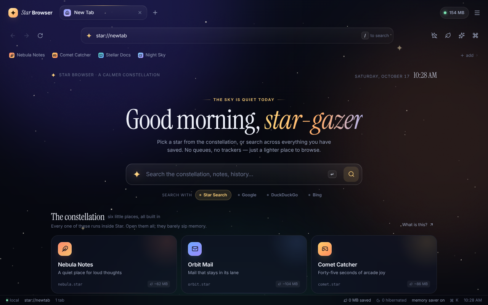
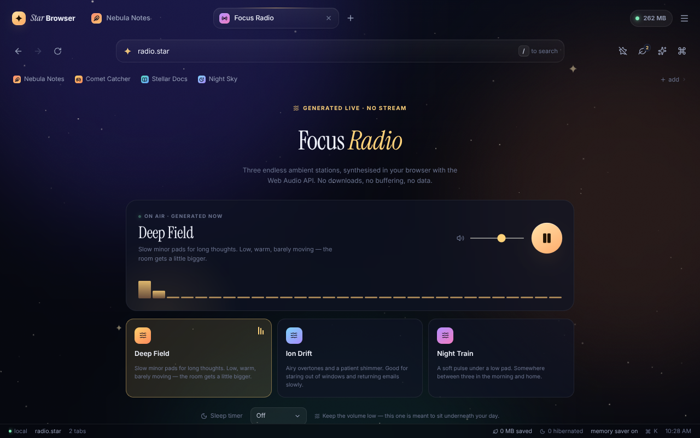
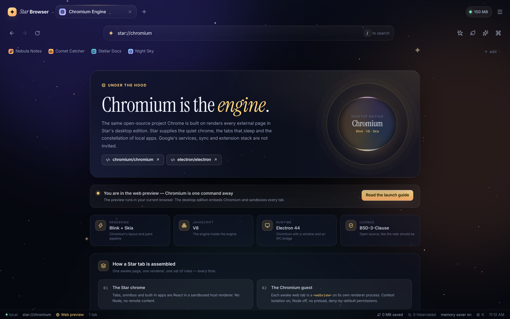

<div align="center">

# ✦ Star Browser

**A calmer, lighter Chromium browser — a little extra, a lot less RAM.**

The open-source engine Chrome is built on, wrapped in a quiet shell with notes,
mail, radio, a comet game and a night-sky guide — and tabs that genuinely
release their memory when they sleep.

`React 19` · `TypeScript` · `Vite` · `Chromium via Electron` · no accounts, no telemetry

[**Download for Windows, macOS or Linux →**](https://github.com/wilsonschteingara0-blip/star-browser/releases/latest)

</div>

---

## Why another browser?

Chrome is a great engine and a heavy neighbour. Star keeps the engine and drops
the entourage: no sync client, no background updater, no extension stack, no
Google services baked in. What is left is a small, quick shell with genuinely
useful things built in, and an aggressive attitude toward tabs you are not using.

- **Tabs hibernate — for real.** A background tab idle for ten minutes
  (configurable) goes to sleep. In the desktop app that destroys its Chromium
  renderer process, not just its visibility. Click it and it wakes at the same
  address with the same session.
- **Memory you can read.** On Chromium, each web tab's figure comes from the
  operating system's process counters via `getProcessMemoryInfo()`. The
  hibernation saving is the memory that actually went back.
- **The shell is small.** The initial bundle is ~110 KB gzipped, and the six
  built-in apps are code-split — a page you never visit costs nothing.
- **A constellation of real tools.** Notes, a mail client, generative ambient
  radio, an arcade game, a sky guide and the manual. All local, all functional.
- **Local by default.** No accounts, no sync, no analytics. Bookmarks, history,
  settings, notes and mail live in `localStorage` on this device.

## Two ways to run Star

| | Desktop edition | Web preview |
| --- | --- | --- |
| Engine | **Chromium** (via Electron) | Your current browser |
| External pages | Load in real tabs, sandboxed per tab | Hand-off portal to your system browser |
| Hibernation | Destroys the renderer process | Unmounts the page/app |
| Memory panel | Measured from Chromium processes | Conservative model |
| Start it | `npm run desktop` | `npm run dev` |

Both share the same interface and the same local-first model. Each installation
keeps its own local data (the desktop app stores it under its own Electron
profile), so the two editions do not sync with each other. The web preview is
what you see if you open the project in a browser; the desktop edition is the
actual browser.

## Screenshots

| New tab | Constellation |
| --- | --- |
|  |  |

## Run it

The quickest route is a pre-built installer from
[Releases](https://github.com/wilsonschteingara0-blip/star-browser/releases/latest):
AppImage, Windows setup and an Apple Silicon DMG, Chromium included. They are
unsigned, so Windows SmartScreen and macOS Gatekeeper will ask the first time.

Or build it yourself:

```bash
npm install       # also downloads the Chromium runtime (~120 MB, one time)
npm run desktop   # build Star, then open the Chromium window
```

For development, with Vite hot reload inside the Chromium shell:

```bash
npm run desktop:dev
```

Or use the web preview on its own:

```bash
npm run dev       # http://localhost:5173
npm run build     # type-check + production build into dist/
npm run preview   # serve the production build
```

If your network blocks Electron's binary download, set a mirror before installing:
`ELECTRON_MIRROR="https://npmmirror.com/mirrors/electron/" npm install`.

## Chromium, honestly

Star's desktop edition is a Chromium browser. The engine is the official
open-source project — the same codebase Chrome is built from — wired in through
[Electron](https://github.com/electron/electron). Nothing is forked, patched or
rebuilt here:

- **[chromium/chromium](https://github.com/chromium/chromium)** — the official
  GitHub mirror of the Chromium source. Star uses the Chromium build that ships
  with Electron 44.
- **[electron/electron](https://github.com/electron/electron)** — the runtime
  that packages Chromium and gives Star its window, its preload bridge and its
  process lifecycle.

**What Star adds:** the tab strip, omnibox, command palette, built-in apps,
hibernation logic, memory panel and the rest of the chrome — all React, all
local. **What Star removes:** Google's services, sync, accounts, the extension
stack and background updaters. The engine tab tells you the exact versions at
`star://about#engine` and `star://settings#engine`.



### How an external tab works

1. The active tab's page is a `<webview>` guest in the renderer, pointed at a
   shared `persist:star` session so logins survive restarts.
2. The main process forces **context isolation on, Node off, sandbox on** for
   every guest, strips preloads, and only allows `http(s)` guests.
3. The toolbar's back/forward/reload drive the guest's **real session history**
   through a small controller registry.
4. Hibernating or closing the tab unmounts the guest. Chromium terminates its
   renderer. That is the memory saving — there is no hidden page left running.
5. Links that ask for a new window become new Star tabs. Downloads use the
   native save dialog. A right-click gets a real browser menu.

Guest permissions are deny-by-default; only fullscreen and clipboard writes are
granted. Camera, microphone, location, MIDI and notifications are refused.

**Why doesn't this repo contain Chromium's C++ source?** Chromium is a
multi-gigabyte C++ project built with GN and Ninja; vendoring the tree would
dwarf Star and take hours to compile. The official Chromium build is delivered by
Electron, and the source is one click away at
[chromium/chromium](https://github.com/chromium/chromium). The in-app engine page
at `star://chromium` shows exactly which build is running.

## The memory story, honestly

**Desktop edition:** web-tab memory is read from Chromium's process counters, so
the panel shows what a page actually costs. Star's own shell baseline is still a
conservative estimate. Hibernation is the real feature: the page state is
discarded, the guest process is destroyed, and clicking the tab reloads it on a
fresh renderer. When Chromium shares one renderer between same-site tabs, those
tabs report the same figure — the same caveat every browser's task manager has.

**Web preview:** a browser does not expose process memory to a page, so the
figures are a deliberate model. The behaviour is still real — canvas loops stop,
Web Audio graphs are torn down, components unmount. The habit is the feature.

## External pages

In the **desktop app**, typing an address loads the site in a real Chromium tab,
inside Star. In the **web preview**, external addresses open the **portal**: a
small hand-off page that opens the site in your system browser, with copy-link,
bookmark and back actions. That is also why the address bar shows a globe
instead of a star for those pages.

## The constellation

| Page | Address | What it is |
| --- | --- | --- |
| Nebula Notes | `nebula.star` | A quiet, local-first notes app with autosave |
| Orbit Mail | `orbit.star` | A demo inbox: folders, starring, compose, replies |
| Comet Catcher | `comet.star` | 45-second canvas arcade game, mouse/touch/keyboard |
| Stellar Docs | `docs.star` | The manual — engine, memory, shortcuts, privacy |
| Focus Radio | `radio.star` | Three ambient stations synthesised live with Web Audio |
| Night Sky | `sky.star` | Moon phase, sun times, constellations, meteor showers |

Star's own pages live under `star://`:

`star://newtab` · `star://search?q=…` · `star://chromium` · `star://history` ·
`star://bookmarks` · `star://settings` · `star://about` ·
`star://external?url=…` (the web-preview portal)

## Keyboard

Single keys work when you are not typing in a field. Browser shortcuts work even
when a Chromium page has focus.

| Key | Action |
| --- | --- |
| `/` | Focus the address bar |
| `t` | New tab |
| `⌘K` / `Ctrl K` | Command palette |
| `⌘F` / `Ctrl F` | Find in page (Chromium tabs) |
| `⌘L` / `Ctrl L` | Focus the address bar |
| `⌘W` / `Ctrl W` | Close the active tab |
| `⌘⇧T` / `Ctrl Shift T` | Reopen the last closed tab |
| `⌘R` / `Ctrl R`, `F5` | Reload (add Shift for a hard reload) |
| `⌘+` / `⌘−` / `⌘0` | Zoom in / out / reset inside a Chromium tab |
| `⌘Tab` / `Ctrl Tab` | Next tab (add Shift for previous) |
| `Alt ←` / `Alt →` | Back / forward inside a page |
| `h` / `b` / `,` | History / bookmarks / settings |
| `m` | Hibernate idle tabs |
| `z` | Zen mode |
| `u` | Reopen the last closed tab |
| `1`–`9` | Jump to that tab |
| `?` | Shortcut sheet |
| `Esc` | Close a menu, leave zen, exit fullscreen |

## Architecture

```
desktop/
  main.cjs             Chromium shell: window, guest security, shortcuts,
                       downloads, native context menu, memory IPC
  preload.cjs          the small starDesktop bridge (no Node in the renderer)
  icon.png             window icon, rendered from public/star.svg
scripts/
  desktop-dev.mjs      Vite + Electron together, one command
src/
  App.tsx              shell, routing, global shortcuts, zen mode
  store/browser.tsx    reducer + persistence: tabs, history, bookmarks,
                       settings, hibernation, toasts, Chromium URL sync
  components/
    ChromiumLayer.tsx  one sandboxed <webview> per awake external tab
    WindowControls.tsx frameless titlebar buttons
    DesktopBridge.tsx  shortcuts/links/downloads from the main process
    ...                tabs, omnibox, memory panel, palette, status bar
  pages/               star:// pages and the web-preview portal
  apps/                the six constellation apps (lazy-loaded)
  lib/                 URL parsing, search index, sky maths, storage,
                       desktop bridge, navigation controllers
  styles/              design tokens + components + page styles
```

State is a single reducer persisted to `localStorage`; the theme is a
`data-theme` attribute on `<html>` with three token sets (`midnight`, `eclipse`,
`daylight`). No state library, no router — navigation is just a URL on the active
tab. Chromium's live URL, title, favicon and history capability are mirrored into
that model through one `SYNC_TAB` action.

Read [docs/DESKTOP.md](docs/DESKTOP.md) for the desktop build, security model and
known limits.

## Privacy

Star makes no network requests except the page you ask it to open and the
optional Google suggest endpoint for omnibox autocomplete (only while you type in
the bar; it fails silently). Search suggestions from the constellation, history
and bookmarks are computed locally. There is no Star server, no account and no
telemetry.

In the desktop app, sites you visit have the same network reach as they would in
any browser; their own privacy policies apply. Cookies and logins live in
Electron's `persist:star` partition on your machine. Export everything as JSON,
or erase it all, in **Settings → Privacy & data**.

## Known limits

Star is deliberately not a full Chrome replacement: no extensions, no sync, no
profiles, no Widevine DRM and no automatic updates. PDFs fall back to Chromium's
default handling (usually a download) because the bundled viewer plugin is not
enabled. It is one window with good tabs, not a platform.

---

<div align="center">
Made for people who keep too many tabs open.
</div>
